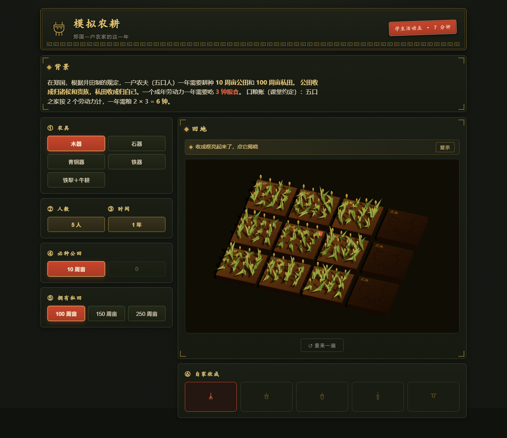

# 模拟农耕 · 郑国一户农家的这一年

初中历史「学生活动五 · 模拟农耕」互动课件：学生选择农具、耕种公田与私田，系统输出自家收成，通过对比五个农具档位的收成差异，体会春秋时期铁犁牛耕如何松动了井田制。

单文件、离线可用：**双击 `index.html` 即可运行**（three.js 已内联，无任何网络请求）。



## 玩法

1. 在左侧 ① 选一种农具：木器 / 石器 / 青铜器 / 铁器 / 铁犁＋牛耕
2. 在 ④ 选择公田（10 周亩，或对铁器/牛耕选 0 弃耕）
3. 在 ⑤ 选择私田规模，种到该农具的产能上限
4. 点 ⑥ 亮起的收成框揭晓，弹出朱砂大印

| 农具 | 私田上限 | 可否弃公田 | 开荒块数 | 自家收成 |
|---|---|---|---|---|
| 木器 | 100 周亩 | 否 | 0 | 8 钟 |
| 石器 | 100 周亩 | 否 | 0 | 8.5 钟 |
| 青铜器 | 100 周亩 | 否 | 0 | 9 钟 |
| 铁器 | 150 周亩 | 可 | 1 | 18 钟 |
| 铁犁＋牛耕 | 250 周亩 | 可 | 3 | 40 钟 |

设计意图：木石青铜被井田制捆死（必须先种公田、产能低），铁器与牛耕出现后农民可以弃耕公田、开垦荒地，收成从 8 钟跃到 40 钟。

## 特性

- **青铜国风视觉**：玄青底、青铜金、铜绿、朱砂；匾额页头、雷纹带、印章标签
- **Three.js 3D 井田**：低多边形粟苗逐块错峰生长、荒地开垦渐变、暖光软阴影、相机视差、悬停高亮
- **收成揭晓**：金色粒子 + 朱砂大印弹窗
- **探索优先引导**：默认中性提示，卡住时点「提示」，点错给一句原因
- **兜底**：WebGL 不可用时自动回退到平面田地；`prefers-reduced-motion` 已适配

## 目录

```
index.html            成品（three.js 内联，离线打开）
src/模拟农耕-模板.html  源文件（引用同名目录下的 three.js）
src/three-0.158.0.min.js
build.py              把 three.js 内联进模板，生成 index.html
preview.png           预览图
```

## 构建

```bash
python build.py   # 生成 index.html
```

## 说明

- 游戏逻辑（常量、状态机、事件语义）与课件原文案数值保持一致
- three.js 0.158.0，MIT License
